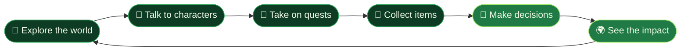

<div align="center">


<a href="https://github.com/codedbydollys10/verdant">
  
</a>

<br><br>

[](https://godotengine.org/)
[](https://docs.godotengine.org/en/stable/tutorials/scripting/gdscript/index.html)
[](#-overview)
[](LICENSE)
[](#-contributing)

<br>

**[Overview](#-overview)** &nbsp;•&nbsp;
**[Features](#-features)** &nbsp;•&nbsp;
**[How It Plays](#-how-it-plays)** &nbsp;•&nbsp;
**[Getting Started](#-getting-started)** &nbsp;•&nbsp;
**[Structure](#-project-structure)** &nbsp;•&nbsp;
**[Roadmap](#-roadmap)** &nbsp;•&nbsp;
**[Contributing](#-contributing)**

</div>

<br>

---

## 🌍 Overview

**Verdant** is an immersive educational adventure game that explores the relationship between human actions and the natural environment. You explore a living world, talk to the people in it, take on quests, and discover environmental challenges first-hand.

Instead of handing players a wall of facts, Verdant lets them **learn by doing**: investigate, make decisions, and see how those decisions influence the world around them.

> 🌱 *Games can do more than entertain. They can spark curiosity and change how we see the world.*

<div align="center">

| 🧭 **Explore** | 📚 **Learn** | 🌿 **Act** |
|:---:|:---:|:---:|
| Discover places, characters, and environmental challenges | Understand climate change and sustainability through play | See how your decisions influence the world around you |

</div>

<br>

---

## ✨ Features

| | Feature | Description |
|:---:|---|---|
| 🌍 | **Interactive World** | Explore a 3D environment filled with locations and objects to discover. |
| 🧭 | **Exploration** | Navigate the game world and uncover different areas. |
| 📜 | **Quest System** | Complete objectives and progress through in-game challenges. |
| 💬 | **Interactive Dialogue** | Talk with characters and learn through conversation. |
| 🎒 | **Inventory System** | Manage the items you collect throughout the adventure. |
| 🗺️ | **Mini-Map** | Stay oriented and understand your surroundings at a glance. |
| 🌱 | **Environmental Awareness** | Engage with climate change, sustainability, and the impact of human activity. |
| 🎵 | **Immersive Atmosphere** | Visuals, sound, and music work together to build an engaging world. |

> [!NOTE]
> Feature availability may vary as development progresses.

<br>

---

## 🎮 How It Plays



<br>

---

## 🛠️ Tech Stack

| | Technology | Purpose |
|:---:|---|---|
| 🎮 | **[Godot Engine 4.3](https://godotengine.org/)** | Game engine and development environment |
| 📝 | **GDScript** | Gameplay logic and scripting |
| 🔀 | **Git** | Version control |
| 🐙 | **GitHub** | Source hosting and project management |

<br>

---

## 🚀 Getting Started

### Prerequisites

| Requirement | Details |
|---|---|
| 🎮 **Godot Engine** | [Version 4.3](https://godotengine.org/download) or a compatible version |
| 🔧 **Git** | [Download Git](https://git-scm.com/) to clone the repository |
| 💻 **Platform** | Any platform supported by Godot: Windows, Linux, or macOS |

### Installation

**1&nbsp;·&nbsp;Clone the repository**

```bash
git clone https://github.com/codedbydollys10/verdant.git
```

**2&nbsp;·&nbsp;Enter the project folder**

```bash
cd verdant
```

**3&nbsp;·&nbsp;Import into Godot**

Launch Godot, click **Import**, and select the `project.godot` file.

**4&nbsp;·&nbsp;Run the game**

Open the project in the editor and press **▶ Run Project** (`F5`).

<br>

---

## 📁 Project Structure

```text
Verdant/
├── documents/                       # Specifications and design docs
│   ├── Functional_Specifications.md
│   └── technical_specifications.md
├── managements/                     # Project management files
├── src/
│   ├── assets/
│   │   ├── characters/
│   │   ├── dialogue/
│   │   ├── fonts/
│   │   ├── music/
│   │   ├── objects/
│   │   ├── sounds/
│   │   └── textures/
│   ├── scripts/                     # GDScript gameplay logic
│   └── interfaces/                  # UI scenes
├── project.godot
├── README.md
└── LICENSE
```

<details>
<summary><b>📂 What lives where</b></summary>

<br>

| Folder | Contents |
|---|---|
| `documents/` | Functional and technical specifications |
| `managements/` | Project management files |
| `src/assets/` | Characters, dialogue, fonts, music, objects, sounds, and textures |
| `src/scripts/` | GDScript gameplay logic |
| `src/interfaces/` | UI scenes and interface elements |

</details>

> [!TIP]
> This is a representative layout. Adjust folder names to match the repository as it evolves.

<br>

---

## 🎯 Goals

| | Goal |
|:---:|---|
| 🌿 | Encourage environmental awareness through interactive gameplay |
| 🧩 | Make educational content engaging with exploration and quests |
| 🌎 | Show how games can communicate real-world challenges |
| 🎒 | Blend learning, discovery, and problem-solving into one enjoyable experience |

<br>

---

## 🔮 Roadmap

- [ ] 🗺️ More explorable locations and quests
- [ ] ⚡ Richer interactive environmental challenges
- [ ] 💬 Expanded characters and branching dialogue
- [ ] 🌦️ Dynamic world changes based on player decisions
- [ ] ♿ Improved accessibility, interface design, and gameplay feedback

<br>

---

## 🤝 Contributing

Contributions, ideas, and feedback are welcome!

1. 🍴 **Fork** the repository
2. 🌿 **Create** a branch: `git checkout -b feature/your-feature`
3. 💾 **Commit** your changes: `git commit -m "Add your feature"`
4. 📤 **Push** the branch: `git push origin feature/your-feature`
5. 🔀 **Open** a Pull Request

Found a bug or have an idea? [**Open an issue**](https://github.com/codedbydollys10/verdant/issues).

<br>

---

## 📄 License

Verdant is released under the **[MIT License](LICENSE)**. You are free to use, modify, and distribute it, provided the license notice is included.

<br>

---

<div align="center">

## 🌱 Our Vision

We believe games can do more than entertain. They can encourage curiosity, inspire reflection, and help players see the world from a different perspective.

**Verdant is a step toward making environmental learning interactive, engaging, and memorable.**

<br>

🌿 &nbsp;**Restore the balance. Shape a greener future.**&nbsp; 🌿


</div>
